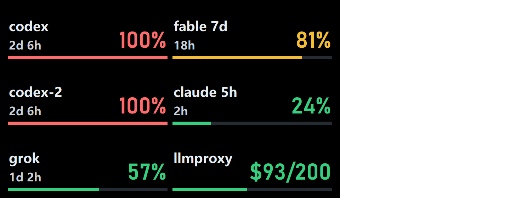
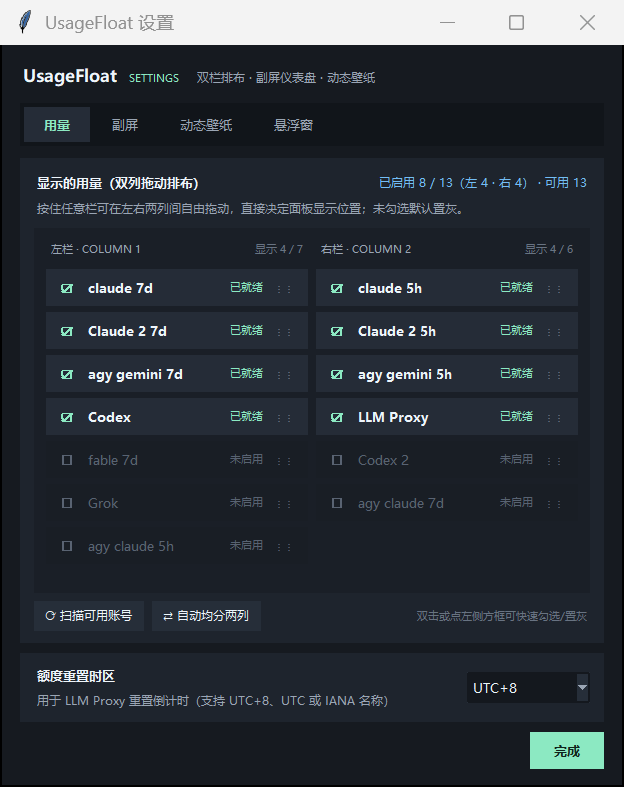
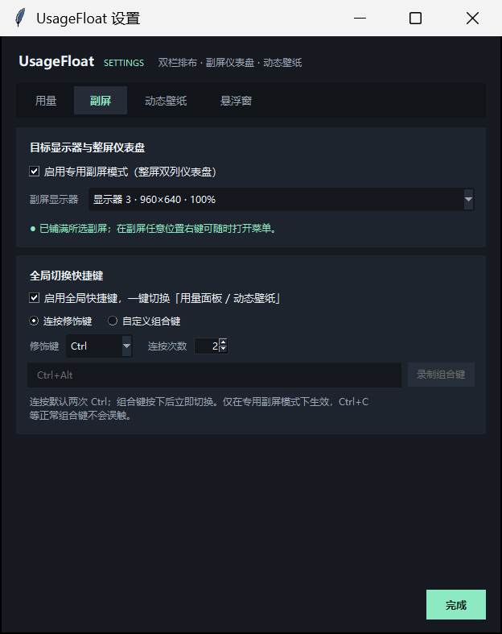
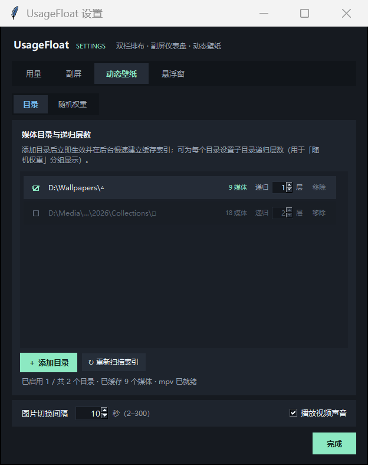
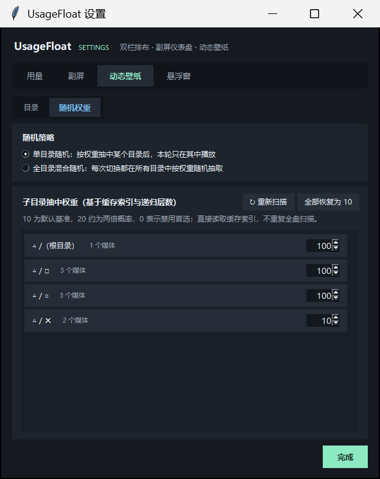

# usage-float

Windows 用量 HUD：把 Claude / Codex / Grok / Antigravity 订阅用量（以及可选的 LiteLLM 代理额度）铺在专用副屏上，双击 Ctrl 切到文件夹动态壁纸。无标题栏、不占任务栏。

## 截图

专用副屏用量面板：



用量设置（双列自由拖动排布、未勾选默认置灰）：



副屏与快捷键设置：



动态壁纸目录与递归层数（立即添加、后台慢扫描索引、超长路径省略中间段）：



动态壁纸目录权重（PlayStation △□○✕ 为示例目录名）：



## 安装与启动

**发行包（推荐）**：从 [Releases](https://github.com/iikawa-games/usage-float/releases) 下载 `usage-float-*-windows-x64.zip`，解压后双击 `UsageFloat.exe`。不需要 Python，已内置 mpv。未签名程序可能触发 SmartScreen，选「仍要运行」即可。开机自启在右键菜单里开关。

**源码运行**：Windows + Python 3.10+（带 tkinter）。动态壁纸需先执行 `.\install-mpv.ps1`，或把 `mpv.exe` 放到 `vendor/mpv/`。

```powershell
python usage_float.py once          # 命令行看一眼（发行包：UsageFloat.exe once）
pythonw usage_float.py              # 浮窗 / 副屏
.\start.vbs                         # 脱离当前会话启动
python usage_float.py autostart on  # 开机自启
```

## 凭证

凭证都在本机，不经过第三方服务器：

| Provider | 默认凭证 |
|---|---|
| Claude | `~/.claude/.credentials.json` |
| Claude 第二账号 | `~/.claude-2/.credentials.json`（可用 `CLAUDE_HOME_2`） |
| Codex | `~/.codex/auth.json` |
| Codex 第二账号 | `~/.codex-2/auth.json`（可用 `CODEX_HOME_2`） |
| Grok | `~/.grok` 登录态 |
| Antigravity | 官方 `agy` CLI 的登录态（1.1.11+）；支持 PATH、`%LOCALAPPDATA%\agy\bin\agy.exe` 或 `ANTIGRAVITY_CLI_PATH` |
| LiteLLM 代理 | 环境变量 `LLM_PROXY_API_KEY` + `LLM_PROXY_ENDPOINT`，或配置里的 `llm_proxy_api_key` / `llm_proxy_endpoint` |

登录第二个 Codex 账号：

```powershell
$env:CODEX_HOME="$env:USERPROFILE\.codex-2"; codex login
```

## 交互

| 操作 | 效果 |
|------|------|
| 点击左下角刷新区 / `F5` | 刷新 |
| 点击 Codex 用量数字 | 该账号的重置卡列表 |
| 点击 `claude 7d` / `claude 5h` 数字 | Claude 用量重置 / 5 小时重置 |
| 拖动 | 移动悬浮窗 |
| 右键 | 刷新 / 设置 / 切换专用副屏 / 置顶 / 开机自启 / 退出 |
| 快捷键（默认连按两次 Ctrl） | 用量仪表盘 ↔ 动态壁纸 |
| `Esc` | 退出 |
| `Home` | 复位到主屏角落 |

## 设置

右键 → **设置…**。

**用量**

- **双列拖动排布**：直接将每个栏在左右两列间自由拖动，决定副屏面板显示位置；未勾选的项默认置灰
- **扫描可用账号**：检测本机可用的 provider，状态统一显示「已就绪 / 未启用 / 未检测到」；登录是否有效以实际用量查询为准
- **快速勾选 / 自动均分**：点击左侧方框或双击任意栏即可切换启用/置灰；支持一键自动均分两列
- Claude 拆成 `fable 7d`、`claude 7d`、`claude 5h`（以及第二账号 `Claude 2 7d`、`Claude 2 5h`），各自独立勾选与排布
- Antigravity 拆成 `agy gemini 7d`、`agy gemini 5h`、`agy claude 7d`、`agy claude 5h` 四个独立设置项。小浮窗将 Gemini 简称为 `gem`，保留窗口周期
- 没有本机凭证的 provider 不占位；Antigravity 安装 CLI 后会查询。未登录或查询失败时，没有上次成功读数才显示「更新失败」
- LiteLLM 代理的重置时区，默认 UTC+8

**副屏**：选中目标显示器 → 打开「专用副屏模式」。程序按显示器硬件标识锁定副屏，重新插拔后再铺满；显示器被拔掉时临时退回悬浮窗。快捷键也在这一页，可改成连按 N 次或组合键。

**动态壁纸**：添加媒体目录（含子目录），可为每个目录设置子目录递归层数（0–8 层）并为分组加权。

- 添加目录后立即生效，在后台慢速扫描并持久化缓存索引（`~/.usage-float/wallpaper-index.json`），打开「随机权重」直接读取缓存索引，不重复全盘扫描
- 目录名过长时自动省略中间层级，保证完整显示首段与末段
- 支持常见 JPG / PNG / WebP / GIF / MP4 / WebM / MKV / MOV
- 每次进入随机首项；30 分钟以内的视频从头播，更长的优先随机章节，没有章节则随机时间
- 图片默认停留 10 秒（2–300 秒可调）；竖图居中裁成正方形，横图和视频铺满副屏
- 点击副屏后：视频左右键 ±5 秒，图片左右键上一张/下一张，滚轮调音量
- 把视频拖到副屏立即播放，结束后回到轮播
- 切回用量时 mpv 进程退出，不留后台解码

## Codex 重置卡

符合条件的 Plus / Pro 账号会发「用量重置」机会，30 天内自选时间使用。点 Codex 那一行的用量数字打开列表，**每行只动对应账号**。

- 列表 `GET https://chatgpt.com/backend-api/wham/rate-limit-reset-credits`
- 核销 `POST …/consume`，每次带随机 `redeem_request_id`，接口按它去重

## Claude 用量重置

Anthropic 会给符合条件的账号发「用量重置」（CLI 的 `/limit-reset`，内部代号 cedar-ember）。点 `claude 7d` 的数字，弹窗列出每份额度的有效期和能重置的窗口，选中后「使用」并确认。

状态随常规用量请求一起读，**不增加额外调用**：

```
GET https://api.anthropic.com/api/oauth/usage?cedar_ember=1&skip_spend=1
```

这个字段只发给 CLI（普通请求返回 `ineligible_reason: "surface"`），所以请求带上本机已装 Claude Code 的版本号（`User-Agent: claude-cli/<版本>`、`anthropic-client-platform: cli`）。版本号实时读取 `@anthropic-ai/claude-code/package.json`，不写死。

使用时发送与 `/limit-reset` 相同的请求：

```
POST https://api.anthropic.com/api/organizations/<organizationUuid>/reset_rate_limits
{"program": "cedar_ember", "grant_id": "<next_grant_id>", "request_id": "<uuid>"}
```

- 服务端只核销 `next_grant_id` 那一份，其余额度显示为「排队中」、不可选
- 组织 ID 取自 `~/.claude.json` 的 `oauthAccount.organizationUuid`，取不到再查 `/api/oauth/profile`
- 没收到结果（断网、5xx、429）时，重试沿用同一个 `request_id`，不会多扣

### 5 小时重置

点 `claude 5h` 的数字：每周一次、只重置 5 小时会话（内部代号 juniper-tide）。这是实验功能，只有分到 `reset` 组的账号才有，且要真正撞到 5 小时上限才开放。常规用量请求里该字段为 `null`，只有 `?at_wall=1&skip_spend=1` 才会填，所以打开弹窗时单独读一次（只读）。使用时发送：

```
POST https://api.anthropic.com/api/organizations/<organizationUuid>/reset_rate_limits
{"program": "juniper_tide"}
```

没有 `request_id`；每周一次的额度本身防止重复核销（第二次返回 `already_used`）。

## Antigravity 用量

读取官方 CLI 的结构化报告：

```powershell
agy -p /usage --output-format json
```

使用 CLI 自己的登录态，不读取或复制 token。查询在临时空目录运行，不发起模型推理；60 秒超时或超过 1 MiB 输出即停止，并清理该次查询启动的子进程。CLI 低于 1.1.11 时不发送 `/usage`，避免旧版本把它当成模型提示词。

百分比统一显示**已用**（由 `remaining_fraction` 换算）。仅显示报告实际提供的窗口；如果账号只有周额度，不补造 5 小时额度。与独立 Claude 订阅的用量分开显示。

四行共用一次用量查询。旧配置中的 `antigravity` 会在原位置展开成四行；原来关闭整个 provider 的配置也会保持四行关闭。

## LiteLLM 代理用量

LiteLLM 虚拟 key 通常读不到 `/key/info`。刷新时打一次很便宜的 embeddings（失败再试短 chat），从响应头 `x-litellm-key-spend`、`x-litellm-key-max-budget` 读出 `$已用/$额度`。重置倒计时按 LiteLLM 的周规则（每周一 0:00）计算，时区可在设置里改，或用 `LLM_PROXY_TIMEZONE` / `llm_proxy_timezone`。没配 key 就不显示这一行。

## 配置

写在 `~/.usage-float/config.json`，一般用设置页改即可。常用字段：

```json
{
  "always_on_top": true,
  "providers": ["codex", "codex-2", "grok", "claude", "llmproxy", "antigravity:gemini-weekly", "antigravity:gemini-5h", "antigravity:3p-weekly", "antigravity:3p-5h"],
  "provider_order": ["codex", "codex-2", "grok", "claude", "llmproxy", "antigravity:gemini-weekly", "antigravity:gemini-5h", "antigravity:3p-weekly", "antigravity:3p-5h"],
  "disabled_providers": [],
  "refresh_seconds": 300,
  "display_mode": "panel",
  "shortcut_enabled": true,
  "shortcut_mode": "repeat",
  "shortcut_key": "ctrl",
  "shortcut_repeat_count": 2,
  "shortcut_combo": ["ctrl", "alt"],
  "wallpaper_folders": ["D:\\Wallpapers"],
  "wallpaper_image_seconds": 10,
  "wallpaper_audio": true,
  "llm_proxy_api_key": "",
  "llm_proxy_endpoint": "",
  "llm_proxy_budget_duration": "7d",
  "llm_proxy_timezone": "UTC+8"
}
```

`refresh_seconds` 下限 300 秒。额度采集统一由 Token Monitor 服务调度，`tray/usage_backend.py` 复用本模块的 provider 解析器；只有该后台入口调用 `collect_local_usage`。公开的 `fetch_all`、浮窗和 headless 均只读 `/api/unified-usage`，手动刷新走 `/api/local-usage/refresh`；服务不可用时保留匹配账号的快照，绝不直连上游补采。

忙闲来自 Token Monitor 输出的 `~/.route-manager/usage-activity.json`，不再读取另一套 `capacity.json` 忙闲判断。Claude/Codex 按各自账号目录复用原生活动读取器，Pi 使用已有会话 provider 信息和本机账号绑定，归属不明时保持 unknown。后台按账号降频：活跃约 5 分钟、闲置 30 分钟、活动缺失/过期 15 分钟。失败尝试也受该间隔约束，重新打开面板不强刷；手动刷新仍不绕过 429。

面板保留原有标题、数字和布局，不添加「限流退避中」「旧数据」等提示。内部仍保留原采集时间与 stale 标记供路由判断，显示快照不会冒充新额度；`display_snapshots` 中的纯展示历史不会写回路由的 `providers`。缓存写入使用跨进程锁与原子替换。未知百分比不当作 0%。配置文件可能含代理 key，不要提交。

Claude（两个账号）和 Codex 的凭据均只读：令牌轮换交给对应 CLI。认证失败时 GET 最多重读一次 CLI 已更新的凭据，重置额度的 POST 不自动重放。更换登录凭据会使原账号缓存失效；令牌轮换恰好撞上采集时，下次刷新再取得新快照。Codex 的短周期与周额度都进入缓存供路由使用，单个显示格呈现使用率较高的窗口。

统一接口必须标注 `route-manager.local-usage.v1`，显式返回 `claude`、`claude-2` 等本机槽位，并匹配当前凭据指纹。旧 Hub 的泛用 provider alias 不当作账号绑定；接口不匹配时只保留本地快照，不恢复自行采集。浮窗只读额度缓存，写入由统一后台负责；用户主动执行重置卡兑换仍是独立操作。

## 开发

```powershell
python -m unittest test_usage_float.py
.\build-release.ps1    # 生成 dist\usage-float-<version>-windows-x64.zip
```

## 许可

MIT。mpv 为 GPL：源码树不含二进制，由 `install-mpv.ps1` 下载；Release 的 zip 附带 mpv，见 [THIRD_PARTY_NOTICES.md](THIRD_PARTY_NOTICES.md)。
